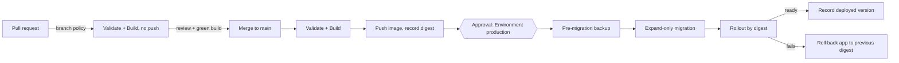

# Solution - GCP Cloud DevOps assignment

> Status: in progress. Sections 1 to 5 are written (stages 2-6). Remaining: assumptions, time and AI disclosure. Other sections are filled in by later stages.
> Each problem follows: cause/risk, exact fix, safe implementation, verification.

## Assumptions, tradeoffs and testing status

- No GCP account is used. **Everything below is "Proposed only"** unless explicitly marked **Tested locally**.
- Region `me-west1` is assumed to offer three zones (`a`, `b`, `c`). Verify with `gcloud compute zones list --filter="region:me-west1"`.
- Figures for failover time are typical, not guaranteed. They must be measured (see verification).
- Tradeoff: three zones cost more than two (extra nodes, standby database). The extra cost buys zone-failure tolerance, which the current design lacks.
- _More assumptions are added by later stages._

## Architecture

See [diagrams/architecture.mmd](../diagrams/architecture.mmd).

## 1. Service interruptions

This problem has two separate parts: **1A** releases and node maintenance (Kubernetes configuration) and **1B** zone outage (infrastructure).

### 1A. Releases and node maintenance

Manifests: [k8s/](../k8s/) (`api-deployment.yaml`, `api-hpa.yaml`, `api-pdb.yaml`). Cause/risk, exact settings and testing for 1A are summarised in [k8s/README.md](../k8s/README.md) and will be expanded in the final document.

### 1B. Zone outage: cause, risk and fix

#### Cause / risk (current state)

| Component | Current setup | What happens if its zone fails |
| --- | --- | --- |
| GKE nodes | Two nodes in **one zone** | Every pod (web, API, worker) is lost together. No capacity remains to reschedule onto. |
| GKE control plane | Zonal cluster = **single control-plane replica** | No API server: no scheduling, scaling, or deployments, and the pipeline cannot reach the private GKE API. |
| Cloud SQL | **Single-zone** instance | The database is unavailable. Recovery means restoring a backup into another zone, which is slow and loses data since the last backup because point-in-time recovery is off. |
| Application | One replica of each component | A single point of failure even without a zone outage. |

Result: a zone outage is a **full outage** with a manual, hours-long recovery. If the zone is the one hosting both nodes and the database, the two failure domains are the same, so nothing masks it.

#### Fix 1: regional GKE cluster (instead of zonal)

A **regional** GKE Standard cluster has these properties:

- The **control plane is replicated across three zones**, so the Kubernetes API stays available and writable if one zone fails. Scaling, rescheduling and deployments keep working.
- Node pools are created **in each chosen zone**. With `--num-nodes=1` and three zones you get three nodes (one per zone). The setting is per zone.
- Pods can be spread across zones with the `topologySpreadConstraints` already defined in [api-deployment.yaml](../k8s/api-deployment.yaml) (`topology.kubernetes.io/zone`, `maxSkew: 1`).

A zonal cluster **cannot be converted in place** to a regional one. The change means **creating a new regional cluster and migrating workloads**.

Capacity rule (N+1 by zone): size each zone so the remaining two zones can carry the full peak load. For example, with peak load needing 2 nodes' worth of capacity, run at least 1 node per zone with the cluster autoscaler allowed to grow each zone (`--min-nodes 1 --max-nodes 3` per zone), so that the surviving zones can scale up when one zone is lost.

Pseudocode (**proposed, not run**; adjust names, network, and ranges):

```bash
gcloud container clusters create survey-regional \
  --region me-west1 \
  --node-locations me-west1-a,me-west1-b,me-west1-c \
  --num-nodes 1 \
  --enable-autoscaling --min-nodes 1 --max-nodes 3 \
  --enable-private-nodes \
  --enable-ip-alias \
  --workload-pool=PROJECT_ID.svc.id.goog \
  --network EXISTING_VPC --subnetwork EXISTING_SUBNET
```

Notes:

- The existing VPC, VPN, HTTPS load balancer and workload identity model stay as they are (the assignment says not to redesign them). The new cluster reuses the VPC. The private control-plane endpoint must remain reachable from the pipeline agent over the VPN, so its authorized networks must include the agent subnet.
- Replica counts: web >= 2, API >= 3 (HPA minimum 3), worker >= 2. With the topology spread, losing one zone leaves at least 2 of 3 API pods running immediately.
- Optional: lower `tolerations` `tolerationSeconds` for `node.kubernetes.io/unreachable` and `not-ready` (default 300 s) to about 60 s so replacement pods are created sooner. Traffic already stops going to the lost pods as soon as their readiness fails, so this only affects how quickly capacity is restored.

#### Fix 2: Cloud SQL in High Availability (HA) configuration

Cloud SQL HA (`availability-type=REGIONAL`) provides:

- A **primary** in one zone and a **standby** in a different zone of the same region.
- **Synchronous** replication of data to both zones (regional persistent disk), so a committed transaction is not lost on failover.
- **Automatic failover** to the standby if the primary or its zone fails. The instance keeps the **same private IP and connection name**, so connection strings do not change.
- Existing connections drop during failover (typically around one to two minutes, to be measured), so the application must reconnect.

Pseudocode (**proposed, not run**):

```bash
# Enable HA on the existing instance (may restart the instance: schedule in a maintenance window).
gcloud sql instances patch SURVEY_DB \
  --availability-type=REGIONAL

# Optional but recommended with HA: keep maintenance predictable.
gcloud sql instances patch SURVEY_DB \
  --maintenance-window-day=SUN --maintenance-window-hour=02
```

Application requirements (otherwise HA does not translate into availability):

- Connection pool with health checks and retry (for example SQLAlchemy `pool_pre_ping=True`, short `pool_recycle`, and bounded retries with backoff on connection errors).
- Request timeouts so requests fail fast instead of hanging during the failover.
- Worker jobs must be idempotent or retried, because a job can fail mid-failover.
- `/readyz` (see [api-deployment.yaml](../k8s/api-deployment.yaml)) may report not-ready during failover. Keep `/healthz` (liveness) independent of the database so the pods are not restarted needlessly.

Important limits:

- **HA is not a backup.** A deletion or corrupt write is replicated to the standby immediately. Backups, point-in-time recovery and file recovery are handled in section 2 (a later stage).
- HA protects against **zone** failure, not **region** failure. A regional outage, or another region's recovery, would need a cross-region replica and is out of scope for this assignment.

#### Other components in a zone outage

| Component | Behaviour |
| --- | --- |
| Cloud Storage (regional bucket in `me-west1`) | Data is stored redundantly across zones in the region, so a single-zone failure does not affect it. |
| Artifact Registry (regional repository) | Regional service, not tied to one zone. |
| HTTPS load balancer | Global/regional managed service. With container-native load balancing (NEGs, see the Service annotation) unhealthy endpoints are removed automatically. |
| **Pipeline agent VM** | A single VM in one zone. If its zone fails, builds and deployments stop, but **the running service is not affected**. Mitigation: keep a recreate-from-image procedure (or a managed instance group of size 1 spanning zones) so the agent can be restored in another zone. This is an accepted tradeoff for a small team. |

#### Behaviour during a zone outage after the fixes

1. Pods and the database primary in the failed zone become unavailable.
2. The load balancer stops sending traffic to the failed endpoints once their health/readiness checks fail.
3. The remaining zones keep serving: at least 2 of 3 API pods, and the web and worker replicas from the other zones.
4. Cloud SQL fails over to the standby in another zone. Requests that need the database may fail for the failover period (typically 1-2 minutes) and then recover automatically after reconnect.
5. The regional control plane stays available, so the HPA and the cluster autoscaler add pods and nodes in the surviving zones.
6. When the zone returns, pods rebalance on the next rollouts and Cloud SQL creates a new standby.

Expected result: **degraded capacity and a short database blip**, instead of a complete outage.

#### Safe implementation

1. Create the regional cluster **next to** the existing one (blue/green at cluster level), deploy the manifests, and test with synthetic data.
2. Enable Cloud SQL HA in a maintenance window, because it can restart the instance. Take an on-demand backup first.
3. Switch traffic at the load balancer (add the new cluster's backend, shift gradually, keep the old cluster until stable).
4. Decommission the old zonal cluster after a stable period.

#### Verification (proposed tests, not yet run)

| Test | How | Pass criteria |
| --- | --- | --- |
| Zone loss, compute | Under steady load (for example `hey` or `k6`), cordon and drain all nodes in one zone: `kubectl cordon` then `kubectl drain` for nodes with `topology.kubernetes.io/zone=me-west1-a` | API error rate stays low; at least 2 API pods stay Ready; replacement pods are scheduled in the other zones |
| Database failover | `gcloud sql instances failover SURVEY_DB` under load | Failover time recorded; application recovers without manual action; no committed data lost; the connection string is unchanged |
| Control plane | Confirm `kubectl get nodes` and deployments still work while a zone is drained | API server stays available |
| Spread check | `kubectl get pods -o wide -l app=survey-api` | Pods are distributed over three zones |

## 2. Backup and recovery

> **Status: design only.** Nothing in this section was run against a cloud environment. The commands are proposals and the draft script [scripts/restore-drill.sh](../scripts/restore-drill.sh) only prints commands by default. Timings are estimates that must be measured in a drill (see "Proving the targets").

Targets: **RPO 15 minutes** (maximum lost database changes), **RTO 2 hours** (service recovered), **deleted files recoverable for 7 days**.

### Cause / risk (current state)

| Area | Current setup | Consequence |
| --- | --- | --- |
| Cloud SQL | Daily automated backup, 7-day retention, **PITR disabled** | The only restore point is the last daily backup. Data loss can be up to about 24 hours, so the 15-minute RPO is **not met**. |
| Cloud Storage | Object versioning and soft delete **disabled** | Deleted or overwritten files are **permanently lost**. |
| Process | Recovery never tested | Unknown real RTO; steps, permissions and consistency checks are unproven. |
| Restore method | Restoring a backup onto the production instance overwrites it | Legitimate changes made after the backup are lost, and a failed restore can make things worse. |

### Backup configuration (before an incident)

**Cloud SQL for PostgreSQL: enable point-in-time recovery (PITR).** PITR continuously archives the write-ahead log (WAL) in addition to daily backups and allows restoring to any second inside the retention window.

```bash
# Proposed, not run
gcloud sql instances patch SURVEY_DB \
  --backup-start-time=01:00 \
  --enable-point-in-time-recovery \
  --retained-transaction-log-days=7 \
  --retained-backups-count=7 \
  --deletion-protection
```

Notes:

- PITR needs automated backups to be enabled (they already are). It only helps for the period **after** it is enabled.
- Log retention of 7 days matches the file-recovery period. The limit depends on the Cloud SQL edition, so confirm it for the edition in use.
- Deletion protection prevents someone deleting the instance (which would also delete its backups).
- Monitor that PITR is healthy: alert if `gcloud sql instances get-latest-recovery-time SURVEY_DB` is more than about 10 minutes behind the current time. This keeps the 15-minute RPO honest.
- Optional: enable database audit logging (for example the `pgaudit` extension) and Cloud Storage **Data Access audit logs** (`DATA_WRITE`) so the incident time, the user and the deleted rows/objects can be identified quickly.

**Cloud Storage: object versioning and soft delete.**

```bash
# Proposed, not run
gcloud storage buckets update gs://SURVEY_UPLOADS \
  --versioning \
  --soft-delete-duration=7d

# Control cost: remove non-current versions after 14 days
cat > lifecycle.json <<'JSON'
{"rule":[{"action":{"type":"Delete"},"condition":{"daysSinceNoncurrentTime":14,"isLive":false}}]}
JSON
gcloud storage buckets update gs://SURVEY_UPLOADS --lifecycle-file=lifecycle.json
```

| Feature | What it protects | Retention | Cost note |
| --- | --- | --- | --- |
| Soft delete (7 days) | Deleted objects (and overwritten ones) can be restored for 7 days | 7 days, matches the requirement | Soft-deleted data is billed during retention |
| Object versioning | Keeps older versions when an object is overwritten or deleted, so a specific version can be restored | Until the lifecycle rule removes non-current versions | Grows with every overwrite; limit with lifecycle rules |

Soft delete alone satisfies "recoverable for 7 days". Versioning is added because it also protects against **overwrites**, with a lifecycle rule to cap cost. Both are low risk to enable and are not applied retroactively (objects deleted before they are enabled stay lost).

### Recovery procedure: deletion at 10:20, discovered at 10:35

Principle: **never restore over production.** Restore to a **new** instance at the point just before the mistake (10:19), then copy back **only what was deleted**. This recovers the deleted data **and keeps all legitimate changes made after 10:19**.

Why not just roll the whole database back to 10:19? Restoring everything to 10:19 and switching to it loses every legitimate change made between 10:19 and the cutover (at least 16 minutes, more in practice). That is more than the 15-minute RPO. The selective restore loses none of them.

Assumptions: the DB tables referencing files are named `surveys` and `uploads` (with an `object_name` column), the operator's deletes did not touch other users' data, and times are Israel local time (convert to UTC for commands; 10:19 local is 08:19 UTC in winter, 07:19 UTC in summer).

| Step | Time (est.) | Action |
| --- | --- | --- |
| 1. Contain | 10:35-10:45 | Declare the incident and name an incident lead. Stop further damage: scale the worker to 0 and put the API in maintenance/read-only mode (or block the operator's access). Record exact times and the user from audit logs. |
| 2. Safety snapshot | 10:45-10:55 | Take an on-demand Cloud SQL backup of the current state, and note the bucket state (the soft-delete retention is already protecting the files). Never skip this: it makes every later step reversible. |
| 3. Restore DB to 10:19 | 10:55-11:40 | Clone the production instance with `--point-in-time` set to 10:19 as a **new** instance (same VPC/private IP configuration, different IP). Confirm the clone's state is `RUNNABLE` and that the deleted rows exist in it. |
| 4. Re-insert deleted rows | 11:40-12:00 | Export the affected tables from the clone, load them into a scratch schema on production, and `INSERT ... WHERE NOT EXISTS` only the missing rows, parents before children (foreign keys), in one transaction. Compare row counts, then commit. Existing rows are never overwritten. |
| 5. Restore files | 12:00-12:15 | List soft-deleted objects in the bucket for the 10:20-10:35 window, and restore those objects (`gcloud storage restore` with `--deleted-after-time` / `--deleted-before-time`, without overwriting live objects). If versioning provides a specific older version, copy that generation back. |
| 6. Consistency checks | 12:15-12:25 | Run the checks below. Fix gaps before reopening. |
| 7. Reconnect and reopen | 12:25-12:35 | The production instance was never replaced, so **no connection-string change** is needed. Scale the worker back up, remove maintenance mode, run smoke tests, then watch errors and latency. |
| 8. Cleanup | After sign-off | Drop the scratch schema, delete the clone, and write a post-incident review. |

Estimated total: about **2 hours** from discovery (10:35 to about 12:35). This is **tight**, and the clone time depends on the database size, so it must be measured. If the clone is slow, the main saving is to start step 3 immediately after step 1 and run step 2 in parallel.

Fallback if the deletion cascaded broadly (many tables) and selective copy is too complex: switch the application to the clone (changing the Cloud SQL connection/secret and restarting), after stopping writes. Accept the loss of changes between 10:19 and the cutover, report it to the business, and document that the RPO was exceeded.

### Consistency between database and files

The database holds records pointing to objects. After recovery, both sides must agree:

1. **Database to bucket:** every `uploads.object_name` must exist in the bucket. List the names from the database, list the bucket, and use `comm -23` to show names present in the database but missing from the bucket. This must be **empty**. Anything missing is restored from soft delete or versions, or the record is flagged.
2. **Bucket to database:** `comm -13` lists objects with no record (orphans). **Review them; do not auto-delete.** They may be uploads whose record was lost, or files uploaded during the incident.
3. **Content integrity:** if the database stores a checksum or size, compare it with the object metadata (`gcloud storage objects describe`). If it does not, sample and open a few files.
4. **Referential integrity:** run foreign-key and orphan-row queries on the restored tables (for example, uploads without a survey).
5. **Application checks:** open a sample of restored surveys, download their files, and generate one report end to end through the worker.
6. **Counts:** restored row/object counts equal the numbers deleted (from audit logs and soft-delete listing).

Sign-off from the owner is required before removing maintenance mode.

### Proving the targets (verification)

Run a **restore drill** in a non-production project using synthetic data of production-like size, at least once now and then regularly (for example every quarter).

1. Seed the database and bucket. Record a timestamp `T0`.
2. At `T0 + 1 min` delete some rows and objects (simulating the operator), and let other synthetic users keep writing.
3. Start a stopwatch at "discovery" and follow the procedure (or [scripts/restore-drill.sh](../scripts/restore-drill.sh) with `EXECUTE=1`).
4. Record each step's duration. **RTO is met** if service is reopened within 2 hours (target with margin: under 90 minutes in the drill).
5. **RPO is met** if the rows written by other users after the mistake are still present (zero loss with the selective restore), and the PITR clone reflects the restore point within 15 minutes (check `get-latest-recovery-time`).
6. Run all consistency checks above. Save the results and the timings as drill evidence.
7. Confirm alerts fire when PITR falls behind, and that a restored object is downloadable.

### Limits and tradeoffs

- PITR cannot recover from before it was enabled or beyond the retention window; the first deletion before that is not recoverable.
- Cloud SQL HA (section 1B) does **not** replace backups: a delete replicates to the standby immediately.
- A PITR clone is a new instance with a new IP, so a full cutover to it requires configuration changes (and downtime), which is why selective restore is preferred.
- Soft delete and versioning increase storage cost, and only protect for the configured period. Longer legal retention needs a different policy.
- A regional disaster (the whole region) is out of scope. It would need cross-region backups or replicas.
- This procedure assumes the table and column names above and that the database engine, edition and limits match the assumptions; confirm against the real schema.

## 3. Linux pipeline agent failure

> **Status: design only.** The commands and scripts below were **not run** on a real agent VM and the scripts were not tested (no Linux environment was available locally). Review and test them on a non-critical agent first.

Scripts: [agent-disk-investigate.sh](../scripts/agent-disk-investigate.sh) (read-only), [agent-disk-cleanup.sh](../scripts/agent-disk-cleanup.sh) (dry run by default), and a systemd [service](../scripts/systemd/agent-disk-cleanup.service) and [timer](../scripts/systemd/agent-disk-cleanup.timer).

### Cause / risk

Reading the diagnostic output:

| Observation | Meaning |
| --- | --- |
| `/` is 100G, 99G used, 0 available | The root filesystem is full, so builds fail with `No space left on device`. Docker, the agent and the OS share this one disk. |
| `/var/lib/docker` 76G | The main consumer: images, stopped containers, volumes and build cache. Images are tagged `latest`, so every build leaves the previous image untagged (dangling) with its layers, and nothing removes them. |
| `/opt/ado-agent/_work` 12G | Agent workspaces (checked-out sources, temp files, tool cache). Normal, but it adds up. |
| `/var/lib/other` 4G | Unknown (simplified output); inspect before touching. |
| 76 + 12 + 4 = 92G of 99G | About 7G is elsewhere (OS, logs such as `/var/log` or the journal, `/tmp`). Also check deleted-but-open files and inodes. |

Risks: all builds and deployments stop (a delivery outage). The wrong clean-up can also delete a needed cache (slower builds), break a running job, or corrupt Docker's storage. There is no monitoring, so the first alert is the failure itself.

### Investigation (read-only)

```bash
df -hT /                       # size, type, usage of the root filesystem
df -i /                        # inode usage (also causes "No space left on device")
sudo du -xh --max-depth=1 / 2>/dev/null | sort -rh | head -15   # -x: stay on this filesystem
sudo du -sh /var/lib/docker/* | sort -rh                         # overlay2, containers, volumes, buildkit
sudo docker system df          # reclaimable space by type: images, containers, volumes, build cache
sudo docker system df -v | head -80
sudo docker images -a --format '{{.CreatedSince}}\t{{.Size}}\t{{.Repository}}:{{.Tag}}' | head -40
sudo docker ps -a --size                                         # stopped containers and their size
sudo docker volume ls -f dangling=true                           # unused volumes (list only)
sudo du -h /var/lib/docker/containers/*/*-json.log | sort -rh | head -5   # runaway container logs
sudo journalctl --disk-usage ; sudo du -sh /var/log /tmp
sudo lsof +L1 | head           # deleted files still held open (space not freed)
sudo du -xh --max-depth=2 /opt/ado-agent/_work | sort -rh | head -15
```

`du -x` matters: it avoids counting other mounts. The `docker system df` "RECLAIMABLE" column shows how much each cleanup level can free before anything is deleted.

### What to check before deleting anything

1. **Is a job running?** `pgrep -af Agent.Worker` and `docker ps`. If a pipeline job is active, wait or let it finish. Prefer to **disable the agent in the Azure DevOps pool** (Agent pools > agent > Disable) so no new job starts during cleanup.
2. **Is this really only a build agent?** `docker ps -a` and `docker volume ls` should show no application containers or databases. If something is a persistent service or holds data in a volume, it is not a candidate.
3. **What is in each candidate?** Use the listing commands above. Record what will be deleted (`docker images -a > /var/tmp/images-before.txt`).
4. **Never delete inside `/var/lib/docker` by hand** (for example `rm -rf overlay2/...`). That corrupts Docker. Always use `docker ... prune/rm`.
5. **Delete the cheapest and safest first**, re-check `df -h /` after every step, and stop when there is enough free space (target: below 70%).
6. Docker commands may fail while the disk is 100% full. First free a little space safely: `sudo journalctl --vacuum-size=200M`, `sudo apt-get clean`.

### Safe immediate recovery (in this order)

```bash
# 0. Agent disabled in the pool; no Agent.Worker running.

# 1. Stopped containers older than a day (CI containers should not need to live longer)
sudo docker container prune -f --filter "until=24h"

# 2. Dangling (untagged) images: the leftovers of "latest" re-tagging
sudo docker image prune -f

# 3. Build cache older than 7 days (recent cache is kept so builds stay fast)
sudo docker builder prune -f --filter "until=168h"

# 4. Unused images older than 7 days (not used by any container)
sudo docker image prune -a -f --filter "until=168h"

# 5. Volumes: list first, review, then remove specific ones. Not part of automatic cleanup.
sudo docker volume ls -f dangling=true
sudo docker volume rm VOLUME_NAME            # only after confirming it is unused scratch data

df -h /                                       # confirm the result
```

Notes:

- `until=168h` is based on **creation time**, not last use. A still-needed base image older than 7 days that is not used by a container at this moment may be removed. It is simply pulled again on the next build (slower build, not a failure).
- Containers or images **in use** by a running container are never removed by prune.
- Avoid `docker system prune -a --volumes` on a shared agent: it removes every unused image, all build cache and unused volumes in one go.
- Agent workspace (`_work`, 12G): only when the agent is idle. `_work/_temp` and old per-pipeline folders can be removed. Keep `_work/_tool` (tool cache) unless more space is needed, since it is downloaded again.
- If space is still not enough, escalate in this order: drop all build cache (`docker builder prune -a -f`), then consider growing the disk (see prevention) rather than deleting more.

Finally: re-enable the agent in the pool, trigger one **test pipeline run** to confirm builds work, and write down what freed how much space.

### Prevention

1. **Automatic scheduled cleanup (systemd timer, nightly).** [agent-disk-cleanup.sh](../scripts/agent-disk-cleanup.sh) runs from the [timer](../scripts/systemd/agent-disk-cleanup.timer) at about 02:30. Behaviour: only one instance at a time (`flock`); skips if a job is running (`Agent.Worker`); stops the idle agent service while cleaning and restarts it afterwards; level 1 always (stopped containers, dangling images, old build cache, journal); level 2 above 70% (unused images older than 7 days); level 3 above 85% (all build cache). Volumes are only reported. It defaults to dry run; the service sets `DRY_RUN=0`. A cron entry works the same way, but systemd gives `Persistent=true` (catches up after downtime), logging in the journal and low I/O priority.
2. **Docker limits**, in `/etc/docker/daemon.json`:

   ```json
   {
     "log-driver": "json-file",
     "log-opts": { "max-size": "50m", "max-file": "3" },
     "builder": { "gc": { "enabled": true, "defaultKeepStorage": "30GB" } }
   }
   ```

   This stops runaway container logs and caps BuildKit's cache. Restart Docker after changing it.
3. **Pipeline hygiene.** Immutable tags (section 4) mean old tags can be removed deliberately. Add an `always()` step that removes the image tags built in the run, use a shallow checkout, and clean the workspace (`clean: true`) so `_work` does not grow.
4. **Capacity design.** Put `/var/lib/docker` on a **separate data disk** (for example 200 GB, `data-root` in `daemon.json`) so a full Docker disk cannot break the OS and the agent, and the disk can be resized online. Longer term, treat the agent as disposable: rebuild it from a fresh image on a schedule (for example weekly) instead of letting state accumulate.
5. **Fail early.** Add a first pipeline step that checks free space (for example fail if `/` is above 90% used) with a clear message, instead of failing in the middle of a build.

### Monitoring and alerts

- Install the **Ops Agent** on the VM (Cloud Monitoring). Use the disk metric `agent.googleapis.com/disk/percent_used` for `/` (state `used`).
- Alert policies: **warning at 70%**, **critical at 85%** (page), a **forecast** alert when the disk is predicted to fill within 24-48 hours, and an alert when the agent is **offline** in Azure DevOps or the VM is unreachable. Inode usage deserves its own alert.
- Send notifications to a team channel or email, and keep a short runbook link (this section) in the alert text.
- Review the weekly trend: growth of `/var/lib/docker` shows whether the cleanup thresholds are right.

### Verification (proposed, not yet run)

| Check | How | Pass criteria |
| --- | --- | --- |
| Dry run | `DRY_RUN=1 ./agent-disk-cleanup.sh` on a test agent | Prints the planned commands; deletes nothing |
| Cleanup effect | Fill the test disk with old images and cache, run the cleanup | Usage drops below 70%; running containers untouched |
| Job safety | Start a long pipeline job and run the cleanup | The script skips with "pipeline job active" |
| Timer | `systemctl list-timers`, `journalctl -u agent-disk-cleanup` | Next run is scheduled; logs show before/after usage |
| Alerting | Temporarily lower the alert threshold | Alert is delivered to the channel |
| End to end | Run a normal build after cleanup | Succeeds; compare build time with and without cache |

## 4. Failed release

> **Status: design only.** The pipeline in [pipelines/azure-pipelines.yaml](../pipelines/azure-pipelines.yaml) was **not run** in Azure DevOps. Its YAML syntax was parsed locally (not validated against the Azure DevOps schema). Lines marked `PSEUDOCODE` are environment-specific. Git and CI/CD stay in **Azure DevOps Server**; GitHub is used only for this submission; Jenkins is not used.

### Cause / risk

| Problem today | Consequence |
| --- | --- |
| All images use `latest` | The tag moves, so nobody can say which build is running; "redeploy the old image" is impossible because the old image no longer has a name. Nodes may also run different content under the same tag. |
| Previous deployed digest not recorded | There is no rollback target. |
| Migration runs before the deploy and succeeds, then the API fails | The database is already on the new schema. Rolling back the application does **not** roll back the database. |
| No pull-request checks, no production approval | Untested code reaches production automatically, from any push. |

### Proposed flow



1. **Validate** (every PR and every merge): unit tests, Dockerfile lint, Kubernetes manifest validation.
2. **Build:** image tagged `<BuildId>-<short git sha>` (immutable, traceable to a commit). **PR builds never push.**
3. **Push + record digest:** only for merged code on `main`. The digest (`sha256:...`) is the content hash of the image. Deployment uses `image@sha256:...`, so what was tested is exactly what runs. The digest is saved in a `release.json` pipeline artifact.
4. **Approval:** the deployment job targets the Environment `production`. **Approvals and checks** on that Environment pause the run until an authorised approver accepts (details in section 5).
5. **Before migration:** record the current image (rollback target) and take an on-demand Cloud SQL backup (restore point; see section 2).
6. **Migration** as a one-off Kubernetes Job using the *new* image digest, **expand-only** (see below).
7. **Rollout** with `kubectl set image` by digest and `rollout status` with a timeout (readiness probes and `maxUnavailable: 0` from [k8s/api-deployment.yaml](../k8s/api-deployment.yaml) keep it safe).
8. **Record the deployed version:** cluster annotations (`ci/image`, `ci/previous-image`, `ci/build-id`, `ci/git-sha`) and a `deployed-version.json` artifact. At any time the answer to "what is running?" is a digest linked to a commit.

Excerpt (full draft in [pipelines/azure-pipelines.yaml](../pipelines/azure-pipelines.yaml)):

```yaml
# Immutable tag and digest (excerpt)
- script: |
    SHORT_SHA="$(echo "$(Build.SourceVersion)" | cut -c1-7)"
    echo "##vso[task.setvariable variable=imageTag]$(Build.BuildId)-${SHORT_SHA}"
- script: |
    docker push "$(imageRepo):$(imageTag)"
    REPO_DIGEST="$(docker inspect --format='{{index .RepoDigests 0}}' "$(imageRepo):$(imageTag)")"
    DIGEST="${REPO_DIGEST#*@}"   # sha256:... -> written to release.json
  condition: and(succeeded(), eq(variables.isMainCi, 'True'))

# Deploy by digest, behind an Environment approval (excerpt)
- deployment: deploy_prod
  environment: production          # approvals and checks are configured on this Environment
  strategy:
    runOnce:
      deploy:
        steps:
          - script: kubectl -n survey set image deploy/survey-api api="$(newRef)"   # newRef = image@sha256:...
```

### Recovering from a failed application release

Situation: the migration succeeded, the new version produces API errors.

1. **Stop the damage:** the pipeline fails the rollout, or an operator detects errors. Do not start further releases.
2. **Check migration compatibility first:** was the migration **expand-only** (backward compatible)?
3. **If yes (normal case): roll back the application only.** Set the image to the recorded previous digest (`ci/previous-image` annotation or `deployed-version.json`), wait for `rollout status`, and verify error rate and key flows. The old code works with the expanded schema.
4. **Then fix forward:** correct the defect in a normal PR and release it through the same pipeline.

Keep in mind: **redeploying an old image does not restore the database.** The schema (and any data written by the new version) stays as it is.

### When the migration is incompatible with the previous application

If the new schema breaks the old application (for example a dropped or renamed column, or a new `NOT NULL` column without a default), rolling back only the application will not work. Options, in order of preference:

1. **Roll forward** with a hotfix that works with the new schema (normal PR, same controls). Usually the fastest and safest.
2. A **tested compensating migration** (a "down" script) if it is data-safe. Run it as an explicit, reviewed step; never assume it exists or is safe.
3. **Restore** from backup or point-in-time recovery as the last resort. This loses data written after the restore point. Prefer the selective restore from section 2 (clone, then copy back only the needed rows).

**Prevent it with the Expand/Contract pattern:**

| Release | Schema change | Application |
| --- | --- | --- |
| N (expand) | Add the new column or table (nullable or defaulted). Add, never remove or rename. | Writes both old and new; reads the old |
| N+1 | Backfill data in batches | Reads the new, still writes both |
| N+2 (contract) | Drop the old column, only after N+1 is stable and the previous version can no longer run | Uses only the new |

Rules for migrations:

- Every migration must work with the **previous** application version. This also matters without rollbacks: during a rolling update old and new pods run **at the same time**.
- No `DROP`, `RENAME` or adding `NOT NULL` without a default in the same release as the code change that needs it.
- Set `lock_timeout` and `statement_timeout`, and run large backfills in batches to avoid long locks.
- Take the restore point (backup / PITR timestamp) immediately before migrating, and record it in the release notes.
- Use feature flags for risky behaviour changes, so they can be turned off without a redeploy.

### Verification (proposed, not yet run)

| Check | How | Pass criteria |
| --- | --- | --- |
| Pipeline syntax | Run in a sandbox Azure DevOps project | Stages appear; PR runs never push |
| Digest deploy | Deploy a test image | `kubectl get deploy -o yaml` shows `image@sha256:...`, not a tag |
| Approval gate | Run on `main` | Run waits at `production`; deploys only after approval |
| Failure path | Deploy an image that fails readiness | Rollout fails, rollback step restores the previous digest |
| Compatibility | Run N-1 application against the N schema in CI | Tests pass (this catches non-expand migrations) |

## 5. Git controls

> **Status: design only.** Policies are configured in Azure DevOps (UI or `az repos policy`); none of this was applied. CLI flags below must be verified with `--help` for the installed Azure DevOps CLI extension and Server version.

### Cause / risk

Developers push directly to `main`, and any push can deploy to production. There is no review, no automated check before merge, and no production authorisation. A mistake (or a compromised account) reaches production in minutes.

### Lightweight workflow for a small team

- **Trunk-based:** `main` is the only long-lived branch and is always releasable. Work happens in short-lived branches (`feature/*`, `hotfix/*`).
- Every change goes through a **pull request** to `main`. The PR runs the pipeline (Validate and Build, no push). After review and a green build the PR is merged (squash, for a clean history).
- A merge to `main` builds and pushes the image, then **waits for production approval** (section 4). Merging is not releasing.

### Branch policies on `main` (Azure Repos)

| Policy | Setting | Purpose |
| --- | --- | --- |
| Require a pull request | No direct pushes; remove **"Bypass policies when pushing"** and **"Bypass policies when completing pull requests"** from all groups, including administrators; deny force-push | Nothing reaches `main` without the other controls |
| Minimum number of reviewers | **1** (small team); **2** for sensitive paths. Creator's own vote does not count; reset votes on new pushes | Independent review of every change |
| Path-based required reviewers | `/pipelines/`, `/k8s/`, `/migrations/` need a named group (for example the DevOps group) | Pipeline, infrastructure and schema changes get an expert review |
| **Build validation** | Required (blocking) policy using this pipeline; automatic trigger; expires immediately when `main` changes (valid duration 0) | Merge only with a green, up-to-date build |
| Comment resolution | Required | No ignored review feedback |
| Merge types | Squash only | Linear, readable history that maps one PR to one release |
| Linked work item (optional) | Required | Traceability |

Illustrative commands (**not run**):

```bash
REPO_ID=...   BUILD_ID=...
az repos policy approver-count create --repository-id $REPO_ID --branch main \
  --minimum-approver-count 1 --creator-vote-counts false --allow-downvotes false \
  --reset-on-source-push true --blocking true --enabled true
az repos policy build create --repository-id $REPO_ID --branch main \
  --build-definition-id $BUILD_ID --display-name "PR validation" \
  --queue-on-source-update-only false --manual-queue-only false --valid-duration 0 \
  --blocking true --enabled true
az repos policy comment-required create --repository-id $REPO_ID --branch main --blocking true --enabled true
az repos policy merge-strategy create --repository-id $REPO_ID --branch main \
  --allow-squash true --allow-no-fast-forward false --allow-rebase false \
  --allow-rebase-merge false --blocking true --enabled true
```

### Production release authorisation (pipeline controls)

On the Environment **`production`** (Pipelines > Environments > Approvals and checks):

- **Approvals** from a named approver group; approvers may **not** approve their own run (so author, reviewer and releaser are not all the same person); an approval timeout.
- **Branch control:** only deployments from `refs/heads/main` are allowed. This blocks a deployment from a feature branch even if someone edits the pipeline.
- Optional: **Exclusive lock** (one production deployment at a time) and a business-hours check.
- **Restrict who can change what releases:** the pipeline file is in `/pipelines/` and needs the DevOps reviewers (above); the service connection or agent identity is limited to this pipeline; secrets stay in Secret Manager and permission-restricted variable groups.

### Hotfix flow

An urgent fix follows the **same controls**, only faster:

1. Branch `hotfix/<short-name>` from `main`. (A revert of the offending PR is often the quickest fix: `git revert` in a PR.)
2. Open a PR to `main`. The same branch policies apply: required review (an on-call reviewer is acceptable), and the same green Build validation. **No bypass and no direct push**, even for administrators.
3. After the merge, the same pipeline builds the image and records the digest. The **production approval is still required**, but the approver can be the on-call approver, so it takes minutes.
4. Afterwards: a short post-incident review, and a follow-up PR for anything skipped (for example extra tests).

Why not push directly in an emergency? Urgent changes are exactly when mistakes happen, and the checks (automated build, a second pair of eyes) take only minutes. A proposed fast path for pure rollbacks: re-run the pipeline with a previous recorded digest (still approved at the environment).

### Verification (proposed, not yet run)

| Check | How | Pass criteria |
| --- | --- | --- |
| Direct push blocked | `git push origin main` as a normal user and as an administrator | Rejected (policy) |
| PR cannot merge | Open a PR with a failing test | Merge blocked until fixed and re-validated |
| Review required | Try to approve one's own PR | Does not count |
| Deployment gate | Merge to `main` | Pipeline waits at `production` until approved |
| Branch control | Run the pipeline from a feature branch | Deployment stage blocked by the Environment check |

## Time spent and AI disclosure
_TBD_ - substantial AI assistance is disclosed here (see also the README).
